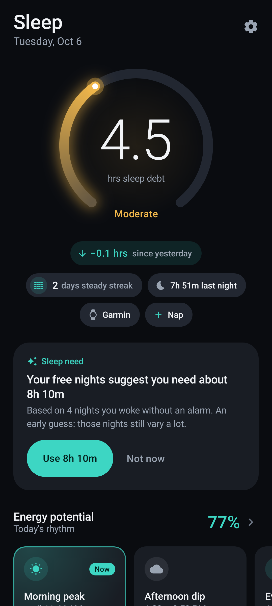
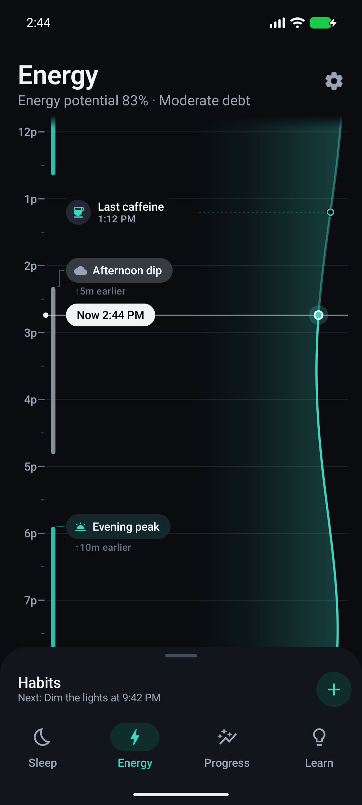
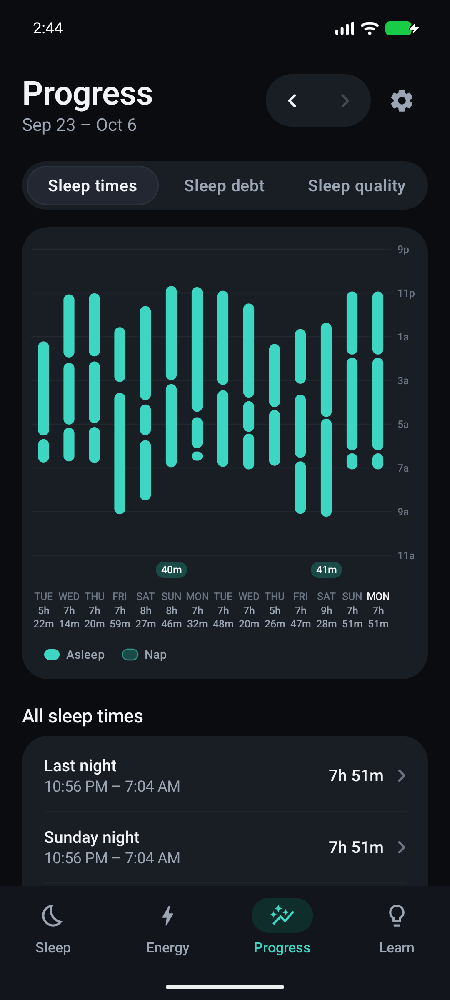
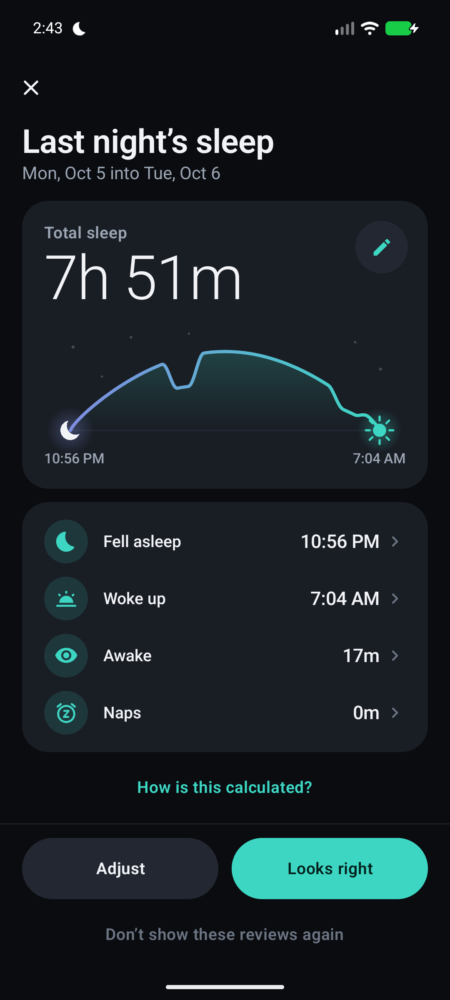
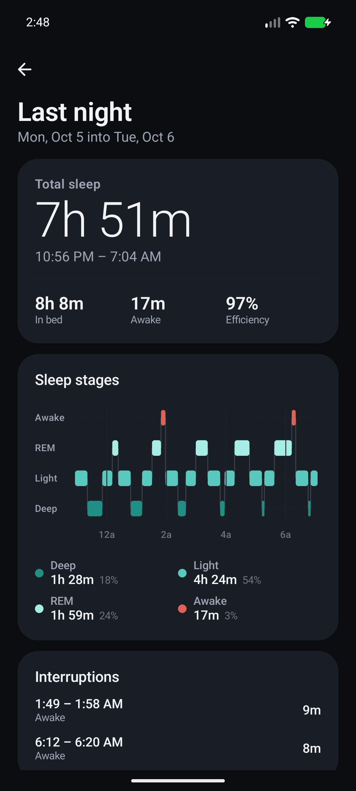
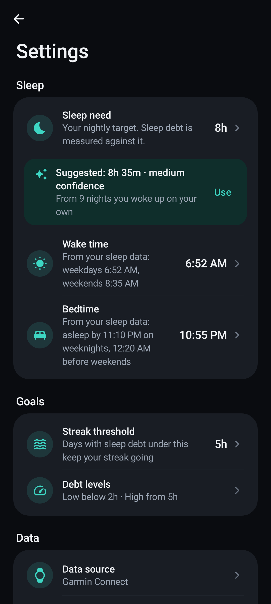

# Sleep Saver

An Android app that turns the sleep your Garmin watch records into things you can act on:

- **Sleep debt**: how far behind your body's sleep need you are over the last 14 nights, as one number.
- **Today's energy schedule**: when you're likely to feel sharp, when the afternoon dip lands, and when to wind down,
  worked out from your sleep and your body clock.
- **Tonight**: an alarm that rings at a restless moment shortly before your wake time, an evening routine of Night
  steps, and a week plan with its own wake time, alarm and routine for each day.

Sleep data comes from Health Connect. Everything is calculated on the phone: there's no account, no network access
and no analytics.

> Sleep Saver is a wellness tool, not a medical device, and it doesn't give medical advice.

<p>
  
  
  
</p>
<p>
  
  
  
</p>

## Features

- **Sleep debt** over 14 nights, with recent nights counting most, plus a status (low, moderate, high) and a streak
  of days kept under your threshold.
- **Sleep need** you can set yourself, or take from a suggestion learned from nights you woke up without an alarm.
- **Energy schedule** for today: morning peak, afternoon dip, evening peak, wind-down and melatonin window, from a
  two-process model of sleep pressure and body clock.
- **Wake time and bedtime learned from your Garmin data**, with weekdays and weekends learned separately. Either can
  be pinned to a fixed time in Settings, and bedtime can instead leave room for your full sleep need.
- **Morning review** of last night. Fix the times, awake minutes or naps if your watch got them wrong. Edits are
  stored separately, so the original data can always be restored.
- **Progress** charts for sleep times, sleep debt and sleep quality.
- **Habits** with gentle, inexact reminders: light in the morning, last caffeine, dimming the lights, wind-down.
- **Home-screen widget** showing your sleep debt and the current energy phase.
- **Learn** articles that explain the ideas behind each number.
- **Demo mode** with made-up nights, so you can explore the app without a watch.
- **CSV export** of your nights, a full **JSON export** of everything, and a full reset that clears everything.

New in v2 (the Tonight tab and the evening):

- **Surfacing alarm**: pick a window of 10 to 45 minutes before your wake time. Around the alarm the phone's motion
  sensor watches for a restless moment, the kind that tends to come with lighter sleep, and rings then. If none comes,
  it rings at the wake time, which always rings. It can also be a plain alarm at a fixed time.
- **Wake-up styles**: Calm, Standard, Firm or Quiet bed (vibration first, then sound), each with a sound that swells
  in, and a snooze that gets shorter each time and never runs much past your wake time.
- **Week plan**: a wake time, alarm, wake-up style and evening routine for each day of the week, plus Day off, Just
  this once and Pause. Copy a day to others or start from a preset. It shows what the week does to your sleep debt
  and how even your rhythm will be.
- **Night steps**: an evening routine of evidence-graded steps (screens down, a warm shower, a cool dark room, reading on
  paper...) timed back from your bedtime, with suggestions from your own nights and guided tools: Slow tide breathing,
  Body scan, Muscle release and Tomorrow list. **Night reset** helps when you're awake in the night.
- **Drop anchor**: tell the app you're settling in. It stays quiet with no clock on screen and learns how long you
  usually take to fall asleep.
- **Hush**: white, pink or brown noise, made on the phone, on a timer that fades it to silence.
- **Catnap**: a short nap timer that says whether now is a good time for a nap.
- **Alarm check** with a **Test ring**: shows anything the phone is blocking (notifications, exact alarms, full-screen
  alarms, battery limits, alarm volume) and lets you hear the alarm in a minute.
- **Morning feel and marks**: rate how you woke up (Foggy to Bright) and tag nights (late caffeine, alcohol, a late
  workout, stress...). After enough nights, **What went with your nights** shows which marks go with better or worse sleep.
- **Keel**: a 0 to 100 score for how regular your sleep times are, with your weekday-to-weekend shift.
- **Wake landing**: after each alarm, what your watch recorded around the ring. Over time the alarm adjusts its own
  sensitivity a little.

How the features were chosen, and which ones were left out, is in
[`docs/COMPETITIVE_ANALYSIS.md`](docs/COMPETITIVE_ANALYSIS.md).

## Install

1. Download `SleepSaver-<version>.zip` from the [Releases](../../releases) page and unzip it.
2. Copy `SleepSaver-<version>.apk` to your phone and open it. Android will ask you to allow installs from that
   source.
3. Open Sleep Saver and connect Health Connect, or choose **Explore with demo data**.

Requirements:

- Android 9 or newer.
- On Android 14 and newer, Health Connect is built in. On Android 9–13, install the Health Connect app from
  Google Play.
- The Garmin Connect app with Health Connect sharing turned on for sleep. Sleep Saver only reads data; it never
  writes to Health Connect.
- For the alarm: allow notifications, and on Android 12 and newer, alarms and reminders. Open **Alarm check** on the
  Tonight tab to see whether anything is still blocking it.

The release APK is signed with a debug key for sideloading. It isn't on Google Play, and updating from an APK signed
with a different key requires uninstalling first, which clears the app's data.

## Build

You need JDK 17 or newer and the Android SDK with platform 37. Point `local.properties` at your SDK
(`sdk.dir=...`), or open the project in Android Studio, which writes that file for you.

```sh
./gradlew assembleDebug            # debug APK: app/build/outputs/apk/debug/
./gradlew :app:assembleRelease     # minified release APK: app/build/outputs/apk/release/
./gradlew :core:domain:test        # domain tests (formulas)
./gradlew testDebugUnitTest        # Android unit tests and screenshot tests
./gradlew lintDebug
```

Screenshot tests use Roborazzi on Robolectric. Every unit-test run records the images to
`<module>/build/outputs/roborazzi/`.

## Trying it without a watch

- **Demo mode**: choose **Explore with demo data** during onboarding, or turn on **Use demo data** in Settings.
- **`tools/hcseeder`**: a debug-only app that writes sample sleep into Health Connect on an emulator. Then pick
  "HC Seeder" as the data source in Sleep Saver, so the real import and sync paths run.

  ```sh
  ./gradlew :tools:hcseeder:installDebug
  adb shell pm grant com.sleepsaver.hcseeder android.permission.health.WRITE_SLEEP
  adb shell am start -n com.sleepsaver.hcseeder/.SeedActivity --es action seed   # or lastnight, clear
  ```

## Project structure

| Module | What's in it |
| --- | --- |
| `app` | Application, navigation, the main activity and the Health Connect privacy-policy screen |
| `core:domain` | Pure Kotlin. Every formula: nights, sleep need, debt, streaks, wake time and bedtime, energy schedule, habits. All tunable numbers live in `SleepConfig` |
| `core:data` | Room, DataStore, Health Connect reading and sync, repositories, CSV export |
| `core:ui` | Theme, shared components and time formatting |
| `core:alarm` | Exact alarms, the ringing and night foreground services, tone and noise synthesis, movement sensing, and the small file that lets alarms ring before the first unlock |
| `core:notifications` | Reminder scheduling and the morning-review notification |
| `core:testing` | Fakes and sample data shared by tests |
| `feature:*` | `sleep`, `energy`, `tonight`, `winddown`, `progress`, `review`, `habits`, `onboarding`, `settings`, `learn`, `widget` |
| `build-logic` | Gradle convention plugins shared by all modules |
| `tools/hcseeder` | Debug tool that seeds Health Connect; not part of the app |

The formulas and constants are written up in [`docs/PLAN.md`](docs/PLAN.md), including the alarm's movement rules
and how it stays reliable through restarts.

## Privacy

- Sleep Saver reads sleep sessions from Health Connect, plus resting heart rate, heart-rate variability and steps if
  you allow them. It stores what it needs in a local database on the phone.
- Around your alarm (only from 15 minutes before its surfacing window opens until it rings, or while the optional
  movement log runs) it reads the phone's motion sensor, reduced to one movement number per 30 seconds; it never uses
  the microphone. It also stores what you enter (marks, Morning feel, Night steps check-offs and Tomorrow lists) and
  what it records: your alarm history (when it rang, snoozes and stops), when you dropped anchor, and when Hush played.
  So that alarms still ring after a restart, a small file the phone can read before you unlock it also holds your next
  alarms and any snooze or catnap, tonight's anchor and Hush settings, a summary of when your watch usually records
  deep sleep, and, until they move into the database, the alarm rings, movement result and Morning feel from before you
  unlock. All of it stays on the phone.
- It has no internet permission, so nothing leaves the device unless you export a CSV or JSON file and share it
  yourself.
- Uninstalling the app, or **Reset all data** in Settings, removes all of its data.
